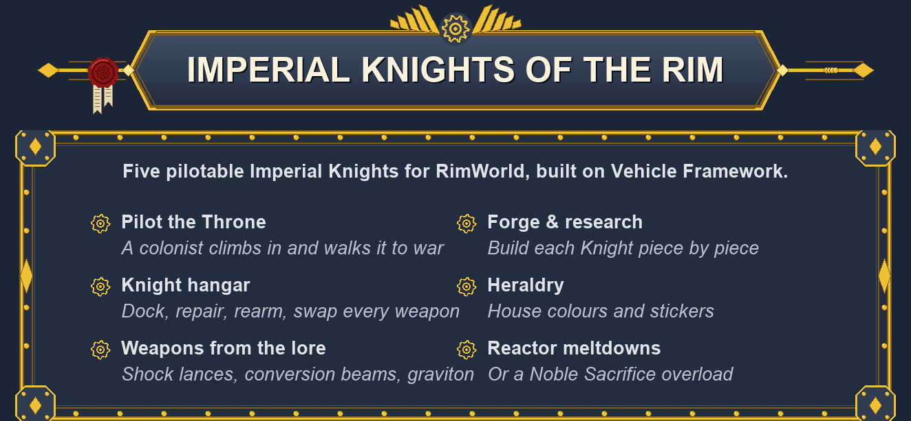
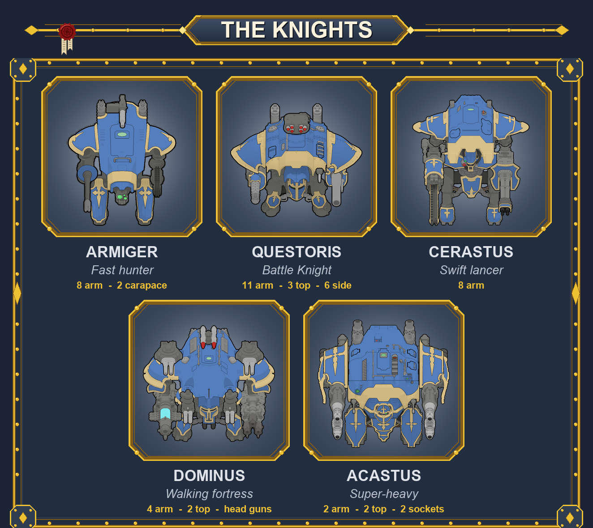

# Imperial Knights of the Rim

A RimWorld 1.6 / 1.7 (beta) mod: pilot towering Imperial Knights across the Rim.

**Steam Workshop:** https://steamcommunity.com/sharedfiles/filedetails/?id=3844956726

**Every weapon, the buildings and the roadmap:** see [docs/infographics](docs/infographics/README.md).

Five Knight classes, each with its own weapons, armour and hangar:

- **Armiger** - the fast, light hunter of the household
- **Questoris** - the classic battle-ready Knight with the widest weapon choice
- **Cerastus** - the swift Knight-Lancer, Acheron, Castigator and Atrapos patterns
- **Dominus** - the heavy Castellan and Valiant with shoulder and carapace guns
- **Acastus Porphyrion** - the super-heavy, with twin magna lascannons or twin conversion beams

## Features

- Piloted walkers built on Vehicle Framework: a colonist climbs into the Throne Mechanicum and walks it to war
- Research the Mechanicum path and build each Knight piece by piece at a forge
- Knight hangar: dock, refit, repair and rearm; change every weapon mount from the hangar cogitator
- Paint your house: two-colour schemes per Knight plus heraldic stickers
- Weapons that behave like the books: shock lances, conversion beams, graviton guns, Ironstorm and Helios missiles
- Reactor meltdowns and the Noble Sacrifice
- Recorded weapon and stomp sounds, weapon glow and muzzle light (adjustable in the mod settings)

## Requirements

- RimWorld 1.6, or the 1.7 unstable beta
- [Harmony](https://steamcommunity.com/sharedfiles/filedetails/?id=2009463077)
- [Vehicle Framework](https://steamcommunity.com/sharedfiles/filedetails/?id=3014915404)

Optional: **Odyssey** (Imperial plasma reactor, orbital Knight drops from a gravship hangar).

Not supported yet: **Combat Extended** - support is planned for a later update.

## Install from GitHub

1. Download this repository (green **Code** button > **Download ZIP**) and unzip it.
2. Put the folder into `RimWorld/Mods/` (for example `RimWorld/Mods/ImperialKnightsOfTheRim`).
3. Enable Harmony, Vehicle Framework and Imperial Knights of the Rim in the mod list, in that order.

Players should normally use the Steam Workshop version - it updates automatically.

## Reporting bugs

Please open an **Issue** on this page (or post in the Bug reports discussion on the Workshop page) and include:

1. What happened and what you were doing
2. Your mod list
3. Your **Player.log** - found in
   `%USERPROFILE%\AppData\LocalLow\Ludeon Studios\RimWorld by Ludeon Studios\Player.log`
   (send `Player-prev.log` instead if you restarted the game after the problem)

## Building the code

The C# source is in `Source/` (`LIK.csproj`, .NET Framework 4.8). It references RimWorld's `Assembly-CSharp.dll`,
`UnityEngine` modules, Harmony and Vehicle Framework's `Vehicles.dll` + `SmashTools.dll` - adjust the reference paths in
`LIK.csproj` to your install, then build; the DLL goes to `Assemblies/`.

## Using and remaking this mod

You are welcome to fork it, remake it, or use the art and code in your own mods - see the licences below.
Please credit **ToxicBuckle565** and link back here.

- **Code** (`Source/`, `Assemblies/`): [MIT licence](LICENSE)
- **Art, pictures and textures** (`Textures/`, `Stickers/`, `Data/`, `About/` pictures): [CC BY-NC-SA 4.0](LICENSE-ASSETS.md) - credit, non-commercial, share-alike
- **Sounds**: made from CC0 recordings - see [CREDITS.md](CREDITS.md)

## Disclaimer

Unofficial, free fan mod. Not affiliated with or endorsed by Games Workshop. Warhammer 40,000, Imperial Knights and all
related names are trademarks of Games Workshop Ltd. No Games Workshop artwork, models or rules text are included.

Some art is based on community 3D models from various, partly unknown sources (see [CREDITS.md](CREDITS.md)). If your
work is used here and you would like credit or removal, please open an Issue and it will be fixed quickly.
