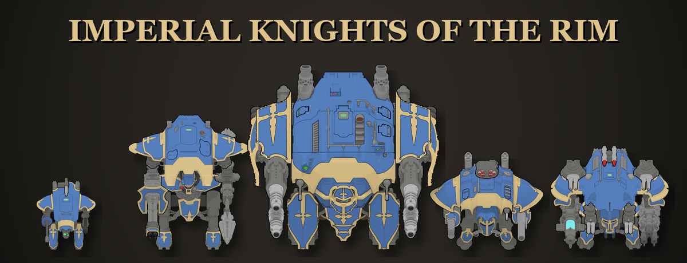
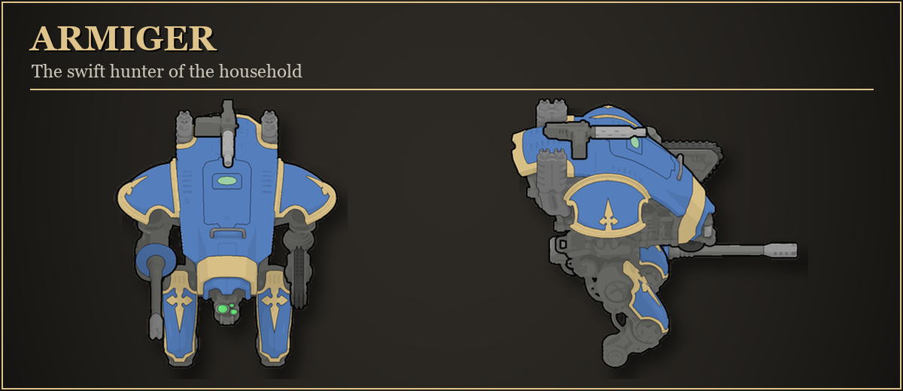
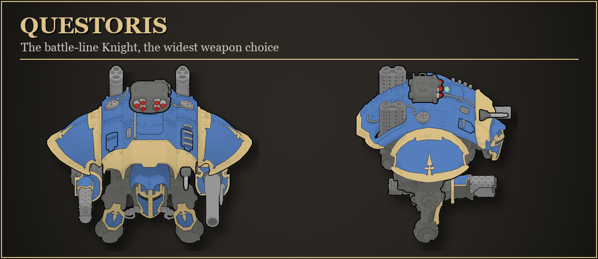
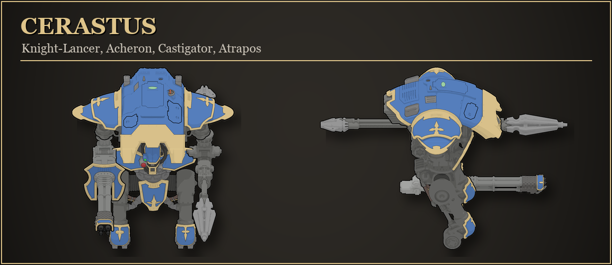
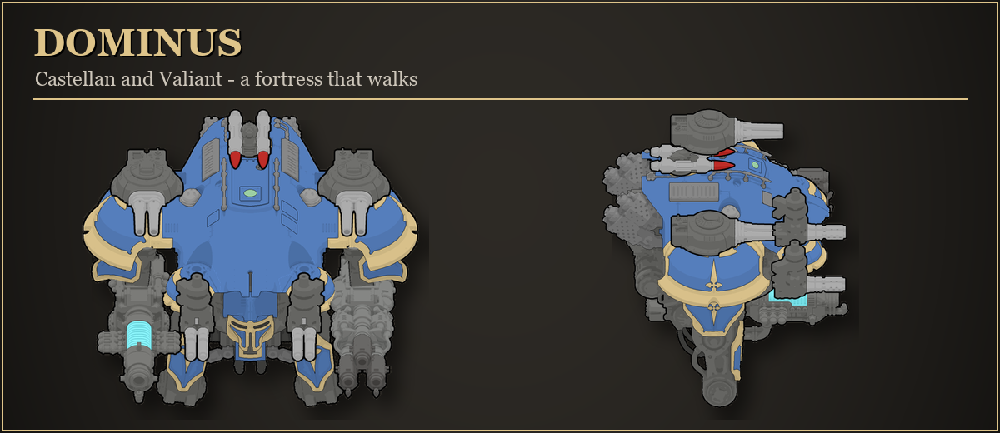
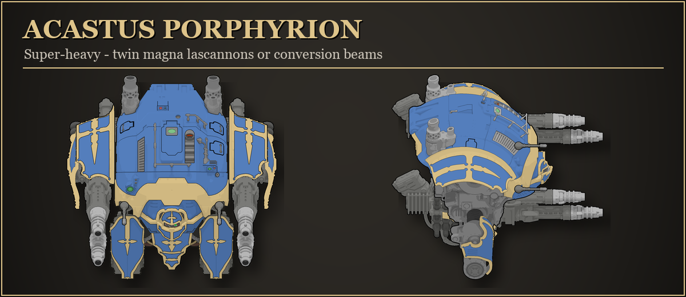

# Steam Workshop page

This is how the [Workshop page](https://steamcommunity.com/sharedfiles/filedetails/?id=3844956726) description is laid out. The Steam (BBCode) source is in [steam_description.txt](steam_description.txt).

---

> *"The Throne remembers every scion who sat upon it. Be worthy of the memory, or be forgotten by it."*
> - Words spoken at the Ritual of Becoming

# Imperial Knights of the Rim
By decree of the Mechanicum, the ancient war engines of the Knightly houses have come to the Rim. Raise a forge, uncover the sacred patterns, and bind a worthy colonist to the Throne Mechanicum - then walk a fortress of adamantium and plasma into the fight.

**Five pilotable Knight classes, built on Vehicle Framework** - each with its own weapons, armour, hangar and paint.

### Armiger - the hunting hound of the household
Light, fast and fierce. Armigers run down prey and screen the greater Knights, their pilots bound as bondsmen to a noble scion.
**Arms:** Armiger autocannon, thermal spear, Reaper chain-cleaver, graviton pulsar, volkite veuglaire, lightning lock, conversion beam cannon, siege claw and rad cleanser
**Carapace:** heavy stubber, meltagun

### Questoris - the backbone of every Knightly house
The classic battle Knight, with the widest arsenal of them all - from the rapid-fire battle cannon to the Thunderstrike gauntlet.
**Arms:** rapid-fire battle cannon, thermal cannon, Avenger gatling cannon, Reaper chainsword, Thunderstrike gauntlet, lightning cannon, volkite chierovile, Hekaton siege claw and rad cleanser, las-impulsor, plasma executor, conversion beam obliterator
**Top carapace:** Ironstorm missile pod, Stormspear rocket pod, twin Icarus autocannon
**Side mount:** heavy stubber, meltagun, multi-laser, phosphor blaster, phased plasma-fusil, graviton crusher

### Cerastus - the swift and the deadly
Leaner and faster than the Questoris, built to strike hard and keep moving. Field it as a Knight-Lancer, Acheron, Castigator or Atrapos.
**Arms:** Cerastus shock lance, ion gauntlet shield, Acheron flame cannon, Reaper chainfist and twin heavy bolter, Castigator bolt cannon, Tempest warblade, Atrapos lascutter, graviton singularity cannon

### Dominus - a fortress that walks
Twin plasma cores feed the heaviest guns a Knight can carry. Slow, unstoppable, and built to break armies.
**Arms:** plasma decimator, volcano lance, conflagration cannon, Thundercoil harpoon
**Shoulders and top mount:** shieldbreaker missile launcher, twin siegebreaker cannon
**Head guns:** twin meltagun

### Acastus Porphyrion - the super-heavy
The rarest and mightiest Knight of all - a towering super-heavy that turns the tide of whole campaigns.
**Arms:** twin magna lascannon, twin conversion beam cannon
**Top launcher:** Ironstorm missile launcher, Helios defence missiles
**Shoulder sockets:** Acastus autocannon, Acastus lascannon

- **The Throne Mechanicum** - a colonist climbs in and pilots the Knight like any vehicle
- **Mechanicum forge** - research the patterns and build each Knight piece by piece
- **Knight hangar** - dock, refit, repair and rearm; swap every weapon mount from the hangar cogitator
- **Heraldry** - paint each Knight in your house colours and add stickers: shields, beasts, crosses, banners, Mechanicus glyphs and more
- **Weapons from the lore** - shock lances that stun and hurl back their target, conversion beams that hit harder the farther the target, graviton guns, Helios missiles that swat drop pods out of the sky
- **Reactor meltdowns** - a fallen Knight may go up like a small sun, or its pilot can overload the core in a Noble Sacrifice
- **Sound and light** - recorded weapon and stomp sounds, weapon glow and muzzle light (adjustable in the mod settings)

**Required** (Steam subscribes you to both automatically):
- [Harmony](https://steamcommunity.com/sharedfiles/filedetails/?id=2009463077)
- [Vehicle Framework](https://steamcommunity.com/sharedfiles/filedetails/?id=3014915404)

**Load order:** Harmony > Vehicle Framework > Imperial Knights of the Rim

## Compatibility
- **Odyssey** (optional) - Imperial plasma reactor for your gravship, and orbital drops: Knights fall from a gravship hangar onto the map below
- **Combat Extended** - supported, patches load automatically
- **RimDark 40k - Mankind's Finest** - its icons show up as extra Knight stickers when installed
- **Camera+** - supported
- Safe to add to an existing save. Removing it mid-save is not supported.

## FAQ
**How do I get my first Knight?**
Research the Knight patterns, build the forge, and assemble the Knight there piece by piece. Then put a colonist on the Throne.

**Do I need Odyssey?**
No - everything except the plasma reactor and orbital drops works without it.

**The game crashed on the very first start after subscribing.**
Make sure Steam has finished downloading everything (the mod is around 130 MB), then start again.

**Why does the game take longer to load?**
The Knights use large, detailed pictures. Loading takes a little longer than with most mods.

## Bugs and feedback
Use the pinned **Bug reports** discussion or open an Issue on GitHub, and please include your Player.log - it makes fixing things much faster.

- **Mod, art and code:** ToxicBuckle565
- **Art** painted from community 3D models. Questoris parts from "Questoris Knight Builder" by Pedjorsi (Thingiverse, CC BY-NC-SA). Dominus based on "Castle Keeper" by Solutionlesn.
- **Sounds** made from freesound.org recordings, all CC0 (full list in About/SOUND_CREDITS.txt)
- **Frameworks:** Vehicle Framework by SmashPhil, Harmony by Andreas Pardeike

Some art is based on community models from various, partly unknown sources. If your work is used here and you would like credit or removal, get in touch and it will be fixed quickly.

## Open source
The whole mod is on GitHub: [github.com/toxicbuckle565-ux/ImperialKnightsOfTheRim](https://github.com/toxicbuckle565-ux/ImperialKnightsOfTheRim)
Code is MIT, art is CC BY-NC-SA 4.0 - remakes, translations and add-ons are welcome, with credit.

*Unofficial, free fan mod. Not affiliated with or endorsed by Games Workshop. Warhammer 40,000, Imperial Knights and all related names are trademarks of Games Workshop Ltd.*
